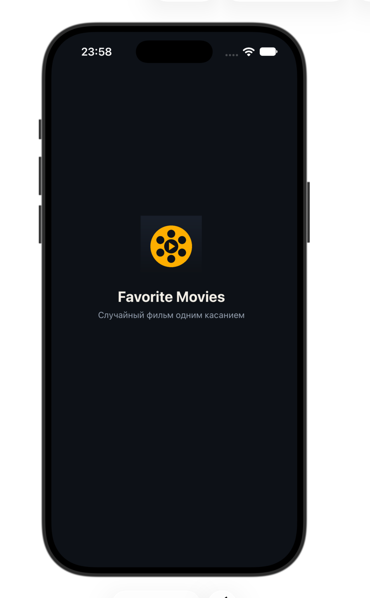
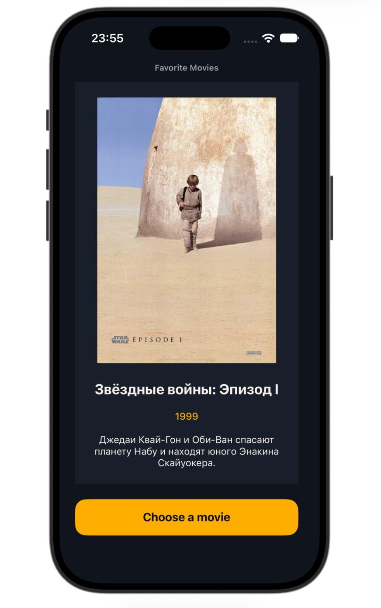
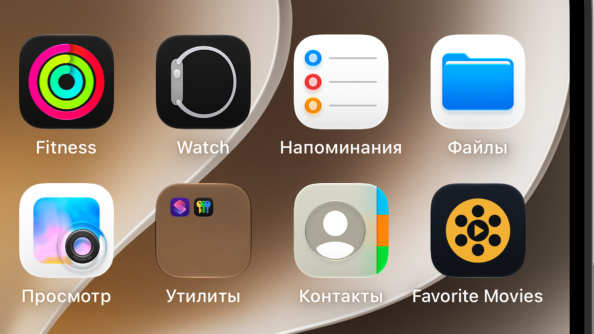

# Favorites Roulette

Одноэкранное iOS-приложение (UIKit + Storyboard, Swift). По нажатию на кнопку показывает случайный фильм из моих 10 любимых: постер, название, год и описание.

## Скриншоты

| Launch screen | Main screen | Home Screen |
|---|---|---|
|  |  |  |

## Как это работает

- Данные: структура `Movie` (название, год, описание, имя картинки) и массив `Movie.favorites` из 10 фильмов. Постеры лежат в `Assets.xcassets`.
- При запуске сразу показывается случайный фильм, экран не пустой.
- По кнопке выбирается случайный фильм из остальных девяти, поэтому один и тот же фильм не выпадает два раза подряд. Постер, название, год и описание обновляются вместе.
- Постер показывается в режиме Aspect Fit (не растягивается), название сжимается до двух строк, описание до четырёх.
- Вёрстка в `Main.storyboard` без Auto Layout (ни одного constraint), приложение рассчитано на iPhone в портретной ориентации.
- Есть своя заставка (`LaunchScreen.storyboard`) и иконка приложения 1024×1024 без прозрачности.

## Запуск

1. Открыть `FavoritesRoulette.xcodeproj` в Xcode.
2. Выбрать симулятор iPhone.
3. Нажать Cmd+R.

## Структура

- `FavoritesRoulette/Movie.swift` — модель данных и массив избранных фильмов
- `FavoritesRoulette/ViewController.swift` — логика экрана
- `FavoritesRoulette/Base.lproj/Main.storyboard` — главный экран
- `FavoritesRoulette/Base.lproj/LaunchScreen.storyboard` — заставка
- `FavoritesRoulette/Assets.xcassets` — постеры, иконка и логотип заставки

Постеры принадлежат их правообладателям и используются только в учебных целях.
