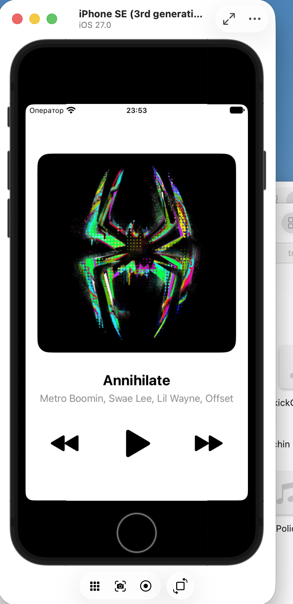
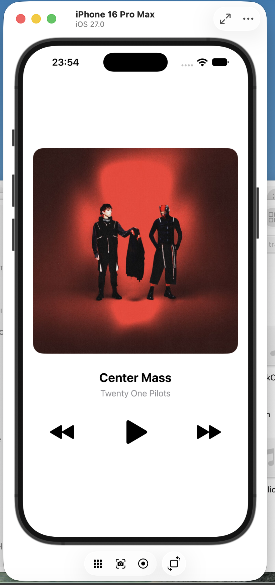

# Music Player

Одноэкранный музыкальный плеер на UIKit: обложка, название трека, исполнитель и кнопки Previous / Play-Pause / Next. Проигрывает аудиофайлы, встроенные в приложение, через `AVAudioPlayer`.

## Скриншоты

| iPhone SE (3rd generation) | iPhone 16 Pro Max |
|---|---|
|  |  |

## Вёрстка

Вся вёрстка в `Main.storyboard`, кода вёрстки нет.

- `Root Stack` (вертикальный): обложка, `Info Stack`, `Controls Stack`
- `Info Stack` (вертикальный): название и исполнитель
- `Controls Stack` (горизонтальный, Fill Equally): Previous, Play/Pause, Next

Constraints только два вида: `Root Stack` прикреплён к Safe Area с отступами 20 pt по бокам и центрирован по вертикали, обложка держит пропорцию 1:1.

## Воспроизведение

- Play/Pause запускает и останавливает трек и меняет иконку `play.fill` / `pause.fill`
- Next / Previous переключают трек по кругу и сохраняют состояние: если играло, новый трек сразу играет
- После окончания трека автоматически включается следующий (`AVAudioPlayerDelegate`)
- Отсутствующий или повреждённый файл не роняет приложение: ошибка выводится в консоль

## Структура

- `Track.swift` — `struct Track` и список треков `TrackLibrary`
- `ViewController.swift` — состояние плеера и обновление экрана
- `Audio/` — 10 аудиофайлов `.m4a`
- `Assets.xcassets` — обложки треков

## Треки

| Трек | Исполнитель |
|---|---|
| Annihilate | Metro Boomin, Swae Lee, Lil Wayne, Offset |
| Center Mass | Twenty One Pilots |
| The Emptiness Machine | Linkin Park |
| Karma Police | Radiohead |
| KICK OUT | Travis Scott |
| Lithonia | Childish Gambino |
| Mr. Solo Dolo III | Kid Cudi |
| Reincarnated | Kendrick Lamar |
| Telekinesis | Travis Scott |
| Timeless | The Weeknd, Playboi Carti |

Треки и обложки принадлежат их правообладателям и используются только в этой учебной работе с разрешения преподавателя. Репозиторий приватный.

## Запуск

Открыть `MusicPlayer.xcodeproj` в Xcode, выбрать симулятор iPhone и нажать Cmd+R. Дополнительная настройка не нужна.
